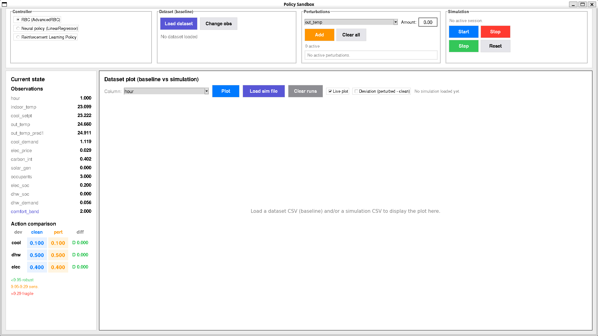

# Omnisafe Wrapper for CityLearn Environment

## Environment Setup

1. Install [miniconda](https://www.anaconda.com/docs/getting-started/miniconda/install)

2. Setup `omnisafe`
```console
# Create conda environment
cd omnisafe
conda env create --file conda-recipe.yaml

# Activate and setup omnisafe
conda activate omnisafe
pip install -e .

# Update torch and torchvision — must use the PyTorch CUDA wheel index
# to get builds that are ABI-compatible with each other.
# Adjust the --index-url suffix (cu128, cu121, cpu, ...) to match your CUDA version.
# Check your CUDA version with: nvidia-smi
pip install torch==2.8.0 torchvision==0.23.0 --index-url https://download.pytorch.org/whl/cu128
``` 

> **Note:** double-check the installed `torch`/`torchvision` pairing after this step
> (`conda list` should show matching CUDA-compatible builds for both).
> Verify the installation with:
> ```console
> python -c "import torch, torchvision; print(torch.__version__, torchvision.__version__)"
> ```
> Expected output: `2.8.0+cu128 0.23.0+cu128`.
> Mismatched versions cause `RuntimeError: operator torchvision::nms does not exist`
> at import time and can silently break GPU support or `torchvision` transforms.

3. Setup `citylearn`:
```console
# From main directory
cd CityLearn
pip install -e .
```

4. Additional requirements
```console
# Progress bar visualization
pip install ipywidgets

# SB3 comparison
pip install stable-baselines3==2.0.0

# LIME — Local Interpretable Model-agnostic Explanations
pip install lime==0.2.0.1 --no-deps

# GUI dependencies (tkinter is included in standard Python installations)
pip install matplotlib pandas
```

> **Note:** `lime` must be installed with `--no-deps` to prevent it from upgrading
> `numpy` to a version incompatible with CityLearn (`numpy<2.0.0` is required).

> **Note:** `tkinter` ships with standard Python on most platforms. On Ubuntu/WSL2 it
> may need to be installed separately: `sudo apt install python3-tk`.

---

## Usage
 
All scripts should be run from the `src/` directory.

### RBC Pipeline (run in order)
 
**Step 1 — Data collection**
```console
python collect_data.py
```
Presents an interactive menu:
- **Option 1 — RBC dataset**: runs a full AdvancedRBC simulation and saves the result to `data/datasets/advanced_rbc_dataset.csv`. Always available; required before training.
- **Option 2 — LinearRegressor dataset**: runs a clean (unperturbed) LinearRegressor simulation and saves the result to `data/datasets/linear_regressor_dataset.csv`. Only available after the model has been trained (Step 2). This CSV is used as the baseline in the GUI when running the neural policy.
- **Option 3 — RL dataset**: runs a clean (unperturbed) simulation using the trained RL actor model `(results/rl_model/actor.pt)` and saves the result to `data/datasets/rl_dataset.csv`. Requires a trained RL agent. Used as the baseline in the GUI when evaluating the RL policy.
- **Option 4 - All available**: runs all available dataset collection steps back to back (RBC, LinearRegressor, and RL). If trained model artefacts for the neural or RL policies aren't available yet, it falls back gracefully to collecting only the available ones without crashing.

**Step 2 — Linear regressor training**
```console
python linear_regressor.py
```
Trains three linear regressors (one per action) and saves the training plots and model weights to `results/linear_regressor/`.

 
**Step 3 — LIME analysis**
```console
python lime_analysis.py
```
Runs the explainability analysis and saves the feature importance plots to `results/lime_analysis/`.

**Step 4 - RL Agent training**
```console
python train.py --episodes <N>
```
Trains the Omnisafe constrained RL agent (PPOLag) on CityLearn for N episodes and saves the TorchScript actor model to `results/rl_model/actor.pt`.
 
**Step 5 — Evaluation and comparison**
```console
python evaluate.py
```
Runs simulations for all available controllers (AdvancedRBC, Linear Regressor, and RL Agent) and saves the metric comparison plots and time-series figures to `results/evaluation_plots/`.

---

### GUI

```console
python gui.py
```

Launches an interactive Tkinter GUI for running and comparing simulations in real time.



**Features:**

- **Controller selection**: switch between RBC (AdvancedRBC), Neural policy (LinearRegressor), and RL policy (Omnisafe actor) at any time.
- **Dataset baseline**: load a pre-collected CSV (`advanced_rbc_dataset.csv` for RBC, `linear_regressor_dataset.csv` for the neural policy, and `rl_dataset.csv` for the RL policy) to use as a clean baseline for comparison.
- **Perturbations**: add, stack, and remove perturbations on any of the three device actions (`cooling_device`, `dhw_storage`, `electrical_storage`) before or during a simulation.
- **Step / Start / Stop / Reset**: run the simulation step-by-step or continuously; stop and resume at any point.
- **Live plot**: toggle live plotting to see the baseline vs. perturbed curves update in real time as the simulation progresses. Legends are kept compact, showing only the run label (`run N`) per curve.
- **Session export**: each simulation session is automatically saved to `data/simulations/sim_<policy>_<timestamp>.csv` for later analysis.
- **Auto-load**: on startup the GUI automatically searches for trained model weights in `results/linear_regressor/` and loads them if found.
- **Live plot**: toggle live plotting to see the baseline vs. perturbed curves update in real time as the simulation progresses. Legends are kept compact, showing only the run label (`run N`) per curve.
- **Session export**: each simulation session is automatically saved to `data/simulations/sim_<policy>_<timestamp>.csv` for later analysis.
- **Auto-load**: on startup the GUI automatically searches for trained model weights in `results/linear_regressor/` and `results/rl_model/actor.pt`, loading them automatically if found.

**Typical workflow:**

1. Collect the appropriate baseline dataset with `collect_data.py`.
2. Launch `gui.py`, select the desired controller, and load the matching dataset.
3. Add perturbations if needed, then start the simulation.
4. Use the plot panel to compare the baseline and perturbed curves across all observations and actions.

---

### Diagnostics

```console
python demonstrate_fix.py
```

Standalone script — not part of the pipeline above — that illustrates a timing/indexing
issue in how CityLearn building objects expose per-timestep state versus what
`env.step()` returns in the observation array.

**The issue:** after calling `env.step(actions)`, the SOC value contained in the
returned `next_obs` is read from `building.electrical_storage.soc[time_step]`, i.e.
the array slot for the **new** internal time step CityLearn has just advanced to —
not the slot that actually holds the result of the action you just executed. That
result instead sits at `soc[time_step - 1]`. Reading `next_obs` naively for "what did
my last action do to the battery" therefore reads the wrong timestep.

**The fix:** when you need the realized outcome of an action rather than the raw
observation, either capture the relevant value from the building object *before*
calling `step()`, or index `soc[building.time_step - 1]` immediately *after* calling
it — don't trust the corresponding entry in `next_obs` at face value. This is the
same correction later applied to `indoor_dry_bulb_temperature` and `dhw_storage_soc`
inside `gui.py`, so this script is a useful reference any time a new per-building
variable needs to be read correctly post-step.

---

## Module Descriptions
 
### `main_rbc.py` — AdvancedRBC
Implements `AdvancedRBC`, a Rule-Based Controller with multi-threshold logic for controlling three building systems:
 
- **`cooling_device`** `[0, 1]`: manages cooling based on indoor temperature, setpoint, predicted outdoor temperature, electricity price, carbon intensity, solar generation and occupant presence. Distinguishes peak hours (12–17) from off-peak and night hours, and applies a configurable comfort band.
- **`dhw_storage`** `[-1, 1]`: manages the charge/discharge of the domestic hot water storage based on SOC level, time of day, DHW demand, electricity price and solar generation.
- **`electrical_storage`** `[-1, 1]`: manages the battery based on SOC, time of day, solar generation, electricity price and carbon intensity.
 
The file also includes `run_simulation()` for running the monthly simulation.
 
---

### `collect_data.py` — Dataset Collection
Interactive script that presents a terminal menu for collecting simulation datasets:

- **RBC dataset** (`data/datasets/advanced_rbc_dataset.csv`): always available; runs a full AdvancedRBC episode and records the 13 observations and 3 actions at each timestep. Used as training data for the linear regressor and as the baseline in the GUI when running the RBC policy.
- **LinearRegressor dataset** (`data/datasets/linear_regressor_dataset.csv`): available only after training. Runs a clean (unperturbed) LinearRegressor episode with the same structure. Used as the baseline in the GUI when running the neural policy.
- **Both**: convenience option that chains the two collections above. If the LinearRegressor artefacts are missing, it skips that half via an `exit_on_missing` fallback rather than aborting the whole run.
- **RBC dataset** (`data/datasets/advanced_rbc_dataset.csv`): always available; runs a full AdvancedRBC episode and records the 13 observations and 3 actions at each timestep. Used as training data for the linear regressor and as the baseline in the GUI when running the RBC policy.
- **LinearRegressor dataset** (`data/datasets/linear_regressor_dataset.csv`): available only after training. Runs a clean (unperturbed) LinearRegressor episode with the same structure. Used as the baseline in the GUI when running the neural policy.
- **RL dataset** (`data/datasets/rl_dataset.csv`): available only after training the RL agent. Runs a clean (unperturbed) simulation using the trained actor model (results/rl_model/actor.pt) and records the same structure. Used as the baseline in the GUI when running the RL policy.
- **All available**: convenience option that runs all available dataset collection steps back to back. If the LinearRegressor or RL model artefacts are missing, it skips those steps via a fallback rather than aborting the whole run.

The script checks for the presence of model artefacts before attempting to collect the corresponding regressor or RL datasets, and skips or exits gracefully with clear guidance if they are missing. The simulation covers one month (719 hourly timesteps).
 
---
 
### `linear_regressor.py` — Linear Regressor
Trains three linear regressors in PyTorch, one per controller action. Each regressor is trained exclusively on the observations that AdvancedRBC actually uses for that specific decision (domain knowledge feature selection), eliminating spurious correlations. The dataset is split temporally: the first 3 weeks (504 timesteps) for training and the last week (215 timesteps) for evaluation. MAE and MSE plots on both train and test sets are produced for each model.
 
Feature subsets per target:
- `cooling_device`: 10 features (temperature, setpoint, demand, price, carbon intensity, solar generation, occupant count, hour)
- `dhw_storage`: 3 features (electricity price, solar generation, hour)
- `electrical_storage`: 2 features (solar generation, hour)
 
---
 
### `lime_analysis.py` — LIME Analysis
Applies LIME (Local Interpretable Model-agnostic Explanations) to the three trained linear regressors to explain AdvancedRBC's decisions. For each target, it selects 5 representative timesteps from the evaluation set (maximum action, minimum action, mean action, worst prediction and best prediction) and computes LIME weights on each of them. It produces a **mean feature importance** plot for each of the three actions, saved to `results/lime_analysis/`. The explainer is built on the training set filtered to domain features only, ensuring that LIME's perturbations stay consistent with the model's input distribution.
 
---

### `train.py` — RL Agent Training
Trains the Omnisafe constrained RL agent (PPOLag) on CityLearn for N episodes using a custom multi-objective reward configuration (with discomfort weight zeroed out, as discomfort is handled by the CMDP cost channel). The trained TorchScript actor model is saved (and overwritten) directly to `results/rl_model/actor.pt`, while the schemas and configuration YAML are persisted for reproducibility.

---
 
### `evaluate.py` — Evaluation & Comparison
Sequentially runs the AdvancedRBC and LinearRegressorAgent simulations (an agent that uses the three trained regressors to produce actions) on the same CityLearn schema, producing three overlaid comparison plots:
 
- **`cooling_device.png`**: `cooling_device` action value, indoor temperature, setpoint and comfort band for both agents
- **`dhw_storage.png`**: `dhw_storage` action value and DHW storage SOC for both agents
- **`electrical_storage.png`**: `electrical_storage` action value and battery SOC for both agents
 
RBC curves are shown as solid lines, regressor curves as dashed lines. Plots are saved to `results/evaluation_plots/`.

---

### `gui.py` — Interactive GUI
Tkinter-based graphical interface for running real-time simulations with perturbations. See the [GUI](#gui) section above for full feature list.

Internally, per-timestep variables that are read directly off the building object for
the live plot (`electrical_storage_soc`, `dhw_storage_soc`, `indoor_dry_bulb_temperature`)
apply the same post-step indexing correction described in [Diagnostics](#diagnostics):
the value the GUI needs is the *result* of the action just taken, not whatever the next
observation happens to report for the upcoming timestep.

---

### `demonstrate_fix.py` — Observation Timing Diagnostic
One-off diagnostic script (not part of the main pipeline) that steps an `AdvancedRBC`
agent through the environment and prints, side by side, the internal
`building.electrical_storage.soc` array and the `electrical_storage_soc` value
returned in the observation, making the off-by-one timing issue between the two
explicit. Kept as a reference for whenever a new per-building state variable needs to
be read correctly after a step. See [Diagnostics](#diagnostics) above.

---